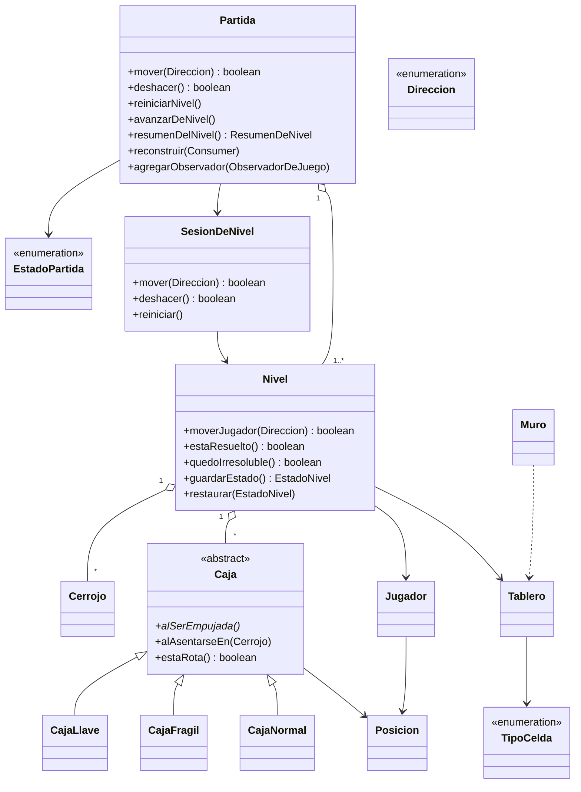
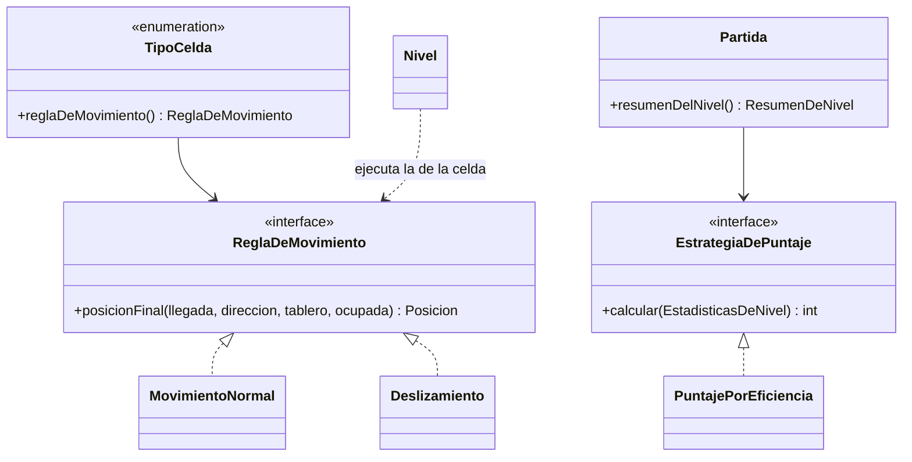
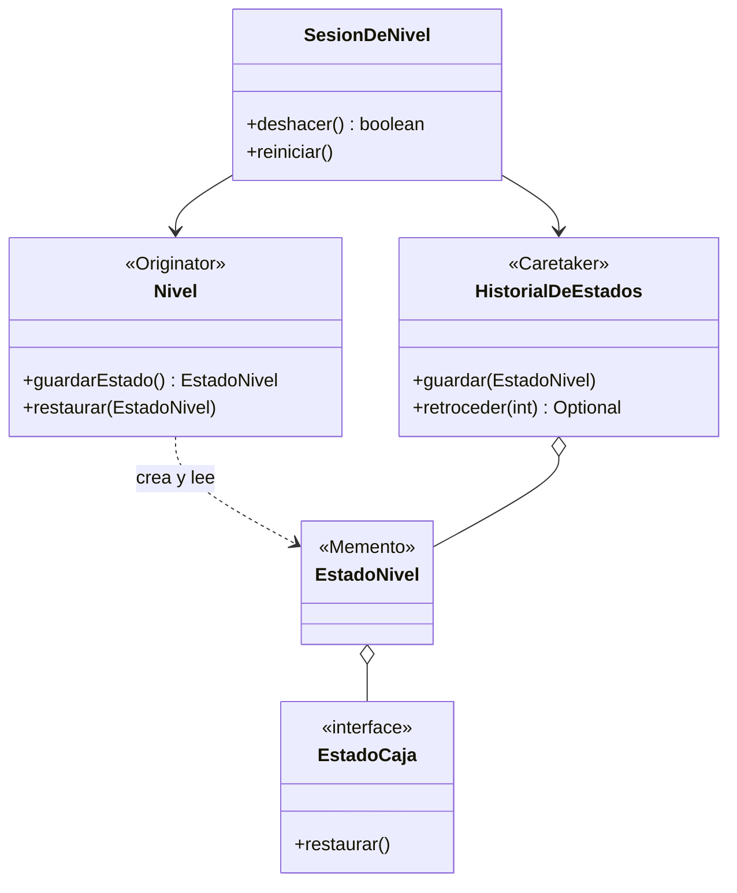
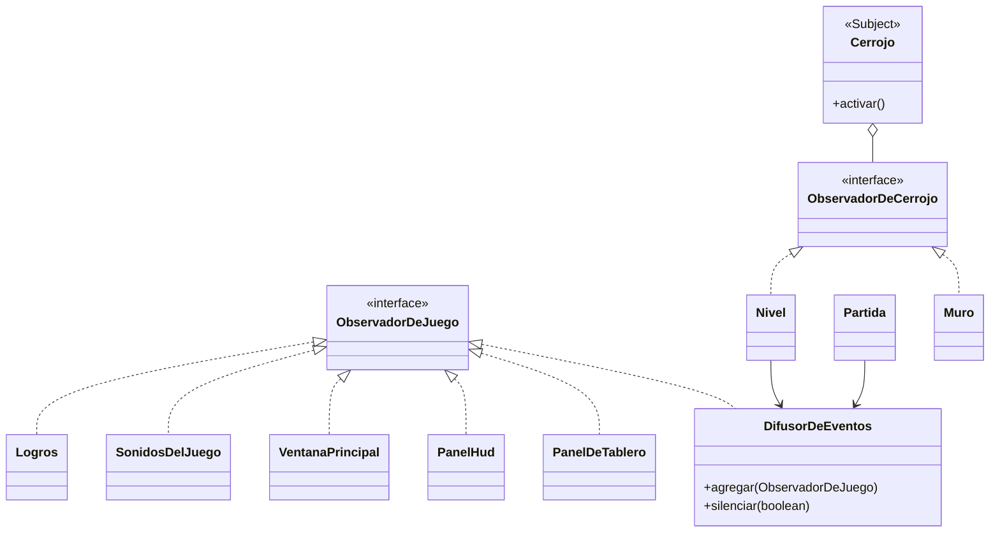
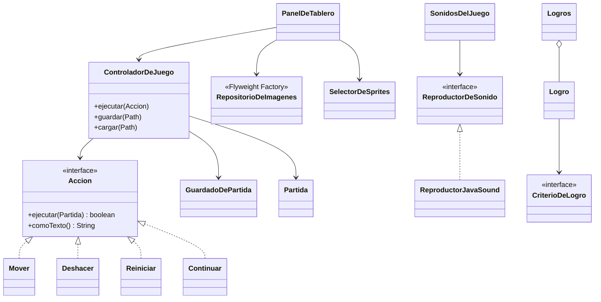
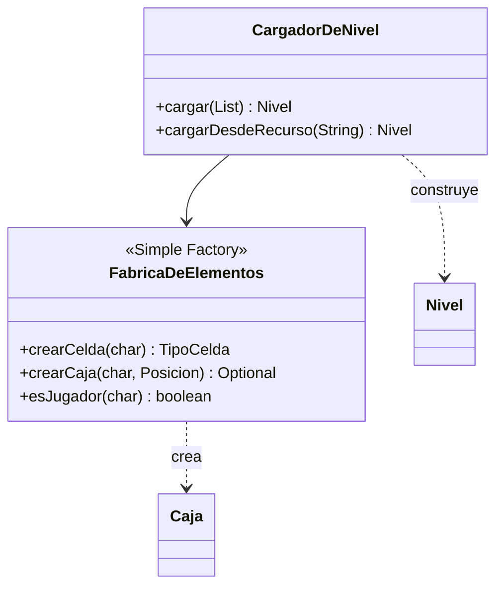

# Diagrama de clases (base para StarUML)

El enunciado (según la skill, sin confirmar) pide el diagrama en **StarUML**. Este archivo es una base en
Mermaid, que GitHub dibuja directamente, para copiar la estructura a StarUML. **No es el entregable final:**
falta armar el diagrama en StarUML y revisar que coincida con el código. Está dividido por tema para que
se lea; los nombres de clases y métodos son los del código.

## Núcleo del juego

## Strategy: terreno y puntaje

## Memento: deshacer y reiniciar

## Observer: eventos, cerrojos, vista, sonido y logros

## Controlador, Command, vista y audio

## Carga de niveles: Simple Factory

